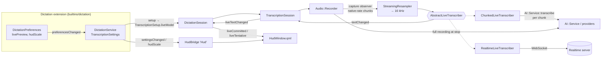
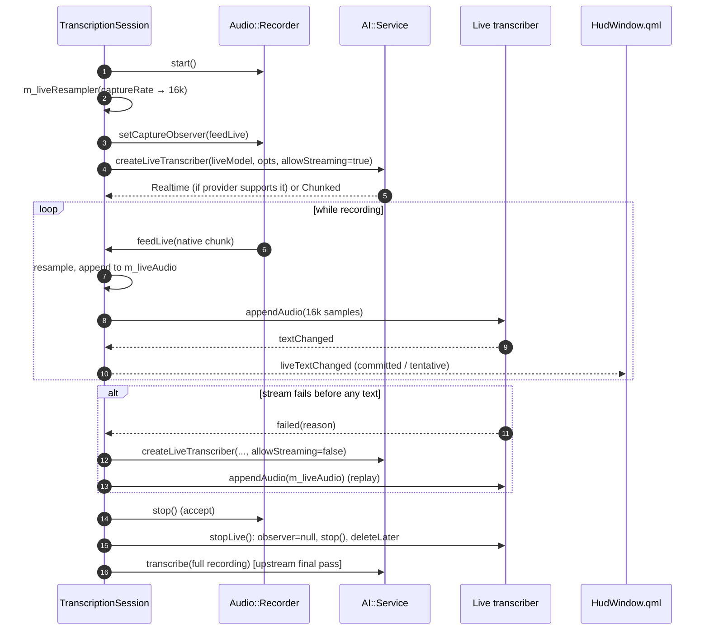
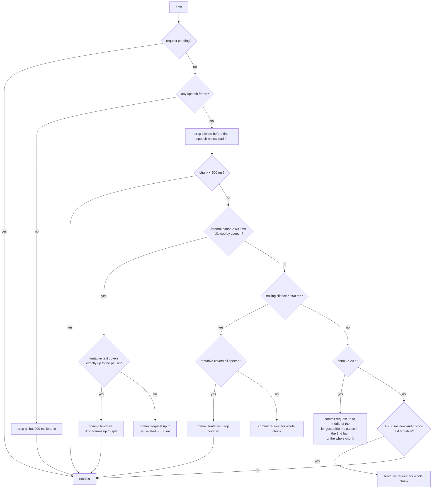
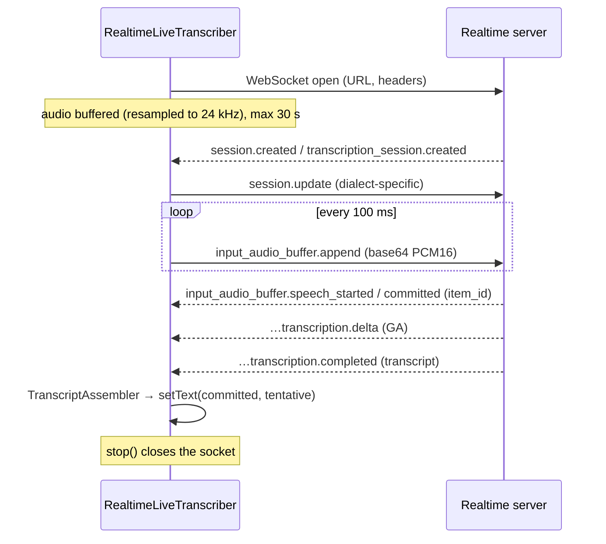
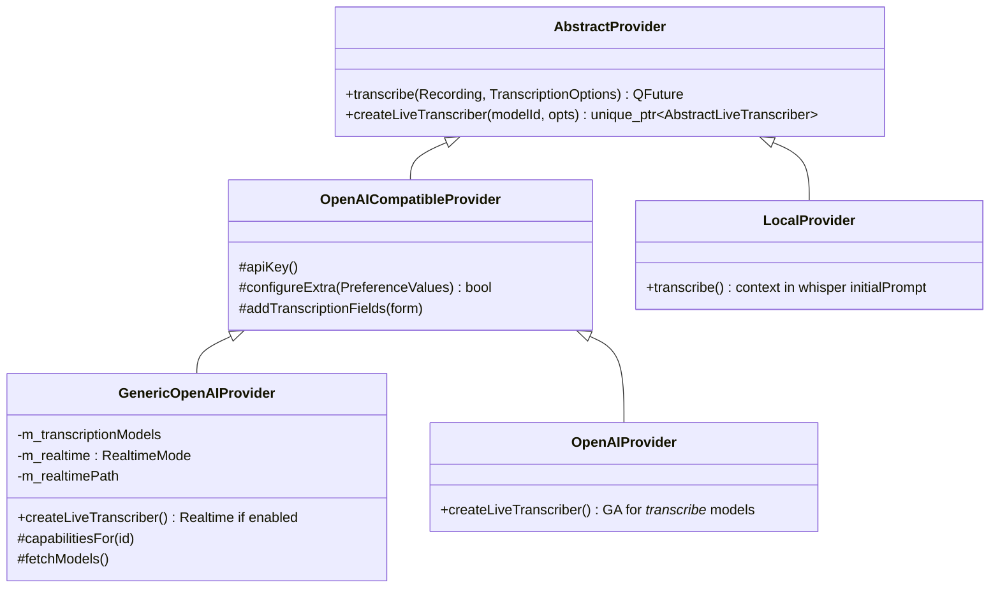

# Vicinae Dictation Extensions

Engineering notes for the `dictate-extensions` branch of my Vicinae fork: what changed, how it is built,
how each part works, and how to extend it. Written so that a person or an AI assistant can regain full
context from this file alone.

> [!NOTE]
> **TL;DR**
>
> - **Branch:** `dictate-extensions` on https://github.com/mattlebeau/vicinae: the squashed feature commit
>   `d8560ce8` on top of upstream `35703147` ("feat(settings): add pop to root search timeout (#2183)"),
>   followed by a docs commit adding these notes and the README link.
> - **Features:** scalable dictation HUD (1–4×), live transcript in the HUD while speaking (chunked or
>   streamed), and speech-to-text through any OpenAI-compatible server (self-hosted or cloud), including
>   OpenAI Realtime API streaming.
> - **Packaged** for Arch as `vicinae-dictate-git`, replacing `vicinae-bin`.
> - **Push-to-talk was attempted and removed** (see [§15](#15-abandoned-push-to-talk)).
> - User-facing guide: `DICTATION-EXTENSIONS.md` at the repo root.

---

## 1. Locations and environment

| What | Where |
|---|---|
| Project folder (`$PROJECT` below) | any folder holding the checkout and the side folders below |
| Git checkout | `…/src` (branch `dictate-extensions`; originally a `--depth 50` clone of upstream) |
| Dev build directory | `…/src/build` |
| Local build deps (Catch2 3.8.1, SPIRV-Headers) | `…/deps/prefix` (sources in `deps/*-src`, builds in `deps/*-build`) |
| Arch package recipe | `…/pkg/PKGBUILD` |
| Isolated test instance | `…/testenv/` |
| User guide (in repo) | `…/src/DICTATION-EXTENSIONS.md` |
| Live config | `~/.config/vicinae/settings.json` |
| Log | `~/.local/state/vicinae/vicinae.log` |

`pkg/`, `testenv/` and `deps/` live outside the repository. `pkg/PKGBUILD` (`_repo`, `_extra_prefix`) and the
`testenv/` scripts contain absolute paths to the project folder; adjust them if it moves.

Git remotes in the checkout:

| Remote | URL | Notes |
|---|---|---|
| `origin` | `https://github.com/vicinaehq/vicinae.git` | upstream, no push access |
| `fork` | `https://github.com/mattlebeau/vicinae.git` | public fork, `dictate-extensions` tracks it |

A local tag `backup/dictate-extensions-presquash` keeps the pre-squash five-commit history (including the
push-to-talk work and its revert).

Developed and tested on Arch Linux with KDE Plasma on Wayland and Qt 6.12. Builds use `GGML_VULKAN=ON` so
the built-in whisper runs on the GPU. The commands below assume `PROJECT` is set, e.g.
`export PROJECT=~/src/vicinae_dictate_extension`, with the checkout in `$PROJECT/src`.

---

## 2. Feature summary

| Feature | User-visible behaviour | Main code |
|---|---|---|
| HUD scale | `hudScale` 1–4 scales the dictation HUD; clamped to screen width | `HudWindow.qml`, `HudBridge::scale` |
| Live transcript | 3-line panel in the HUD; settled text bright, tentative text dimmed; final text still from a full pass | `TranscriptionSession` live path, `services/ai/live/*` |
| Chunked live mode | Works with every transcription model: re-transcribes the current phrase ~1×/s, commits at pauses | `ChunkPlanner`, `ChunkedLiveTranscriber` |
| Streaming live mode | OpenAI Realtime WebSocket API, beta (Speaches) and GA (OpenAI) dialects; falls back to chunked | `RealtimeLiveTranscriber`, `realtime-protocol` |
| OpenAI-compatible speech servers | The generic OpenAI-compatible provider now serves transcription models, detected by name or listed by hand | `GenericOpenAIProvider`, `transcription-model-detection.hpp` |
| Context carry-over | Chunk requests include the end of the settled text as prompt context | `TranscriptionOptions::context` |
| HUD capture hook | `VICINAE_HUD_CAPTURE_DIR` saves a PNG of the HUD every second | `HudBridge` |

---

## 3. Background: Vicinae concepts you need

- **Stack:** C++23, Qt 6 (Core/Quick/QML/Multimedia/WebSockets), glaze for JSON/reflection, CMake + Ninja.
  Binaries: `vicinae-server` (the long-running app, owns all UI and services) and the `vicinae` CLI, which
  talks to the server (`vicinae server`, `vicinae dictation start|stop|toggle|cancel`, `vicinae ping`…).
- **Services** live in `src/server/src/services/` and are reached through `ServiceRegistry`
  (`ServiceRegistry::instance()->dictation()`, `->ai()`, …).
- **Builtin extensions** (`src/server/src/builtins/<name>/`) declare commands and a typed preferences struct.
  `TypedCommandRepository<Prefs>::preferencesChanged(const Prefs&)` is called whenever the user edits
  them; the dictation extension converts its prefs into `TranscriptionSettings` and pushes them into
  `DictationService::setSettings`.
- **Preferences are declared by reflection.** A plain struct with defaults plus a matching
  `PreferenceSchema<T>` holding a `PreferenceMeta` per field (title, description, placeholder, `options`
  or `sections` for dropdowns, `required`, `kind`). Field type drives the widget:
  `bool` → checkbox, `std::string` → text field (or dropdown with `.sections`/`.options`), `double` → text
  field parsed as a number, enum → dropdown (needs a `glz::meta<Enum>` with `glz::enumerate("json-name", Value, …)`).
  Values are stored in `settings.json` under `providers.<extension>.preferences`. A number typed into a
  text field is stored as a string (e.g. `"hudScale": "4"`), and glaze parses it back.
- **AI providers** (`src/server/src/services/ai/`): `AI::AbstractProvider` subclasses, created in
  `AI::Service::createProvider` by type string. Models are referenced as `ModelRef{provider, id}` and written
  `"provider:modelId"` (e.g. `local:whisper-large-v3-turbo-q5_0`). Each model has `Capabilities`
  (`Completion`, `Transcription`, …). Provider types and their config fields are registered in
  `PROVIDER_TYPES` in `ai-provider-types.hpp`; each field set is a struct + `PreferenceSchema`, stored at
  `providers.ai.preferences.providers.<id>.fields`.
- **Upstream dictation pipeline** (unchanged parts):
  `TranscribeCommand` → `DictationService` creates a `DictationSession` (HUD-facing QObject: state,
  controls, rewrite with styles, paste/copy delivery) which owns a `TranscriptionSession` (recording +
  transcription). `Audio::Recorder` captures from the default source at the device's native rate; at stop
  the whole recording is resampled to 16 kHz (windowed sinc) and sent to `AI::Service::transcribe`.
- **HUD:** `HudBridge` is exposed to QML as the singleton `Hud`. `HudWindow.qml` is the shared layout, with
  platform wrappers `HudWindowLayerShell.qml` (Wayland layer-shell), `HudWindowMacOS.qml`,
  `HudWindowWindows.qml`. During dictation `Hud.dictation` is the active `DictationSession`.

---

## 4. Architecture overview



Key design decisions:

1. **Preview and final text are separate.** The live transcriber only feeds the HUD. When recording stops,
   `stopLive()` tears it down and the full recording goes through the normal upstream path. Accuracy can
   never regress, and the live code can fail freely.
2. **One interface, two strategies.** `AbstractLiveTranscriber` hides whether text comes from repeated
   batch requests or a stream. Providers opt into streaming by overriding
   `AbstractProvider::createLiveTranscriber`; everything else gets `ChunkedLiveTranscriber` for free.
3. **Pure logic is isolated for tests.** `ChunkPlanner`, `realtime-protocol`, `StreamingResampler` and
   model detection have no Qt event-loop or network dependencies and are unit-tested directly.
4. **Everything runs on the Qt main thread.** No new threads. Network calls are async (`QFuture::then(this, …)`,
   `QWebSocket` signals); the planner tick is a `QTimer`.

---

## 5. Audio tap and streaming resampler

Files: `services/audio/audio-recorder.{hpp,cpp}` (modified), `services/audio/streaming-resampler.{hpp,cpp}` (new).

- `Recorder` gained a **capture observer**:
  `using CaptureObserver = std::function<void(std::span<const float>)>;`
  `setCaptureObserver(obs)`, `captureSampleRate()`. `processAudioData()` (connected to the audio
  `QIODevice::readyRead`, so main thread) calls the observer with each newly captured mono float chunk at
  the **device's native rate** (e.g. 48 kHz), after updating the level meter.
  `Recorder::stop()` drains the device once more, so the observer also sees the final chunk.
- `Audio::StreamingResampler(inRate, outRate)` converts a chunked stream: `push(span) → vector<float>`,
  `flush()` (emits the held-back tail as if followed by silence). It uses the **same kernel as the
  recorder's whole-recording resampler** (Hann-windowed sinc, 64 phases, half-width
  `ceil(16 × max(1, in/out))` taps, cutoff `min(1, out/in)`), so live audio matches what the final pass hears.
  It tracks absolute sample positions (`m_base`, `m_produced`) and trims its history once more than 8192
  samples are no longer reachable. Output lags by half the filter length. Equal rates pass through unchanged.
- Two resamplers are in play during streaming: native → 16 kHz in `TranscriptionSession` (shared by both
  strategies; `AbstractLiveTranscriber::SAMPLE_RATE = 16000`), then 16 kHz → 24 kHz inside
  `RealtimeLiveTranscriber` (`realtime::SAMPLE_RATE = 24000`, required by the Realtime API).

---

## 6. Live preview lifecycle (`TranscriptionSession`)

Files: `services/dictation/transcription-session.{hpp,cpp}`, `dictation-session.{hpp,cpp}`,
`dictation-service.{hpp,cpp}`.

Settings → setup:

- `TranscriptionSettings` gained `LivePreview {Off, SameModel, OtherModel}`, `liveModel`, `hudScale`.
- `DictationService::setup()` resolves `TranscriptionSetup::liveModel`: `SameModel` → the transcription
  model; `OtherModel` → `liveModel` only if `ai.isAvailable(ref, Capability::Transcription)`; otherwise
  `nullopt`, which means **no live panel at all**.
- `DictationService::setSettings` clamps `hudScale` to `[MIN_HUD_SCALE=1, MAX_HUD_SCALE=4]` (NaN/inf → 1)
  and emits `settingsChanged`.

Session members added: `m_live` (`unique_ptr<AbstractLiveTranscriber>`), `m_liveResampler`,
`m_liveAudio` (all 16 kHz audio so far, for fallback replay), `m_liveStreaming`, `m_liveCommitted`,
`m_liveTentative`; signal `liveTextChanged`; accessors `livePreview()`, `liveCommitted()`, `liveTentative()`.
`DictationSession` re-exposes them to QML as `Q_PROPERTY`s `livePreview` (CONSTANT), `liveCommitted`,
`liveTentative` (NOTIFY `liveTextChanged`).



Details and caveats:

- `startLive(allowStreaming)` builds `LiveTranscriptionOptions{language, vocabulary}` from the dictation
  vocabulary plus `extraVocabulary` (snippet voice phrases), then calls
  `AI::Service::createLiveTranscriber(ref, opts, allowStreaming)`. That asks the provider
  (`provider->createLiveTranscriber(id, opts)`) and, if it returns null or streaming isn't allowed, makes a
  `ChunkedLiveTranscriber`. Logs: `Live transcription: streaming with …` / `… in chunks`.
- **Fallback rule:** on `failed`, if the transcriber was streaming, nothing has been shown yet, and still
  recording → replace with a chunked transcriber and replay `m_liveAudio`. If text was already shown, the
  preview just stops updating (the shown text stays).
- `stopLive()` runs in `accept()` (after `m_recorder.stop()`, so the preview doesn't compete with the final
  request), `cancel()` and `fail()`. It uses `m_live.release()->deleteLater()` because it may be called
  from inside the transcriber's own `failed` handler.
- `m_liveAudio` grows for the whole recording (16 kHz float = 64 KB/s; upstream's recording limit bounds it).

---

## 7. Chunked live mode

Files: `services/ai/live/chunk-planner.{hpp,cpp}` (pure), `chunked-live-transcriber.{hpp,cpp}`.

### 7.1 `ChunkedLiveTranscriber`

- A `QTimer` ticks every **250 ms**: `planner.next()` → publish text → if a request is returned, append
  **300 ms of silence** (models drop a last word that runs into the end of the audio) and call
  `AI::Service::transcribe(model, Recording(16 kHz mono float), options)`.
- `options` = `{language, vocabulary, context}`, where `context` = the **last 200 characters of committed
  text**. Providers put it in the prompt: OpenAI-compatible appends it after the vocabulary in `prompt`
  (600-byte cap, trimmed from the front on a UTF-8 boundary); local whisper uses
  `initialPrompt = vocabulary + ". " + context`. Context is only set for live chunks; the final pass
  doesn't use it.
- Results return via `.then(this, …)`. Success → `planner.complete(id, text)`; failure →
  `planner.abandon(id)` (audio stays queued), and after **3 consecutive failures** it stops and emits
  `failed`.
- Only one request is in flight at a time (the planner refuses while `busy()`), so slow servers simply get
  fewer, larger updates.

### 7.2 `ChunkPlanner` algorithm

Audio is analysed in **20 ms frames** (RMS in dB). Configuration (`ChunkPlannerConfig` defaults):

| Field | Default | Meaning |
|---|---|---|
| `sampleRate` | 16000 | input rate |
| `frameMs` | 20 | analysis frame |
| `minAudioMs` | 600 | never send less than this |
| `minNewAudioMs` | 700 | new audio needed before re-transcribing a growing chunk |
| `pauseMs` | 600 | trailing silence that ends a chunk |
| `maxChunkMs` | 20000 | force a split at the best late pause beyond this |
| `leadInMs` | 200 | silence kept before the first speech |
| `speechAboveFloorDb` | 14 | speech = frame louder than noise floor + this… |
| `minSpeechDb` | −60 | …and louder than this |
| `maxNoiseFloorDb` | −45 | noise floor cap, so speech from t=0 isn't taken for noise |

**Noise floor** = 10th percentile of the last 500 frame levels (history spans chunks), capped at
`maxNoiseFloorDb` (and equal to it with no history).

**State:** `m_samples`/`m_frameDb` (current chunk), `m_pending` (in-flight request: id, frames, commit),
`m_committed`, `m_tentative`, `m_tentativeFrames` (how many frames the tentative text covers).

`next()` decision order (returns nothing while a request is pending):



- `complete(id, text)`: commit requests append `cleanTranscript(text)` to `m_committed` and drop the
  chunk's frames; tentative requests replace `m_tentative` and record `m_tentativeFrames`.
- The **internal pause** rule exists because a pause can pass entirely while a slow request is in flight
  (e.g. a 5 s cold model load); without it the next phrase would be merged into the old chunk forever.
- **Tentative reuse** avoids re-transcribing audio the tentative text already covers.
- `cleanTranscript()` strips `[...]` and `(...)` markers (whisper's `[BLANK_AUDIO]`, `(music)`) and collapses
  whitespace. `joinTranscript()` joins pieces with one space.

Tuning tips: everything is in `ChunkPlannerConfig`; `ChunkedLiveTranscriber` constructs it with only
`sampleRate` set. A noisy mic may need a higher `speechAboveFloorDb`; slower speakers a longer `pauseMs`.

---

## 8. Streaming live mode (OpenAI Realtime API)

Files: `services/ai/live/realtime-protocol.{hpp,cpp}` (pure), `realtime-live-transcriber.{hpp,cpp}`.

### 8.1 Two dialects

| | **Beta** (`Dialect::Beta`) | **GA** (`Dialect::Ga`) |
|---|---|---|
| Who | Speaches, most self-hosted servers | current OpenAI API |
| URL | `ws(s)://<base>/realtime?model=<model>` | `ws(s)://<base>/realtime?intent=transcription` |
| Extra header | `OpenAI-Beta: realtime=v1` | none |
| Auth | `Authorization: Bearer <key>` if a key is set | same |
| `session.update` body | `{input_audio_transcription:{model,language?}, turn_detection:{type:"server_vad", silence_duration_ms:500, threshold:0.5, prefix_padding_ms:300, create_response:false}}` | `{type:"transcription", audio:{input:{format:{type:"audio/pcm",rate:24000}, transcription:{model,language?}, turn_detection:{type:"server_vad", silence_duration_ms:500}}}}` |
| Text events | `…input_audio_transcription.completed` (Speaches sends no deltas) | `.delta` per word, then `.completed` |

Common: audio is sent as `{"type":"input_audio_buffer.append","audio":"<base64 PCM16 LE, 24 kHz mono>"}`.

`realtime::endpoint(httpBase, dialect, model, pathOverride)`: `http→ws`, `https→wss`; default path is
`<base path>/realtime`; a relative override replaces `realtime`, an override starting with `/` replaces the
whole path.

### 8.2 Connection flow



### 8.3 `TranscriptAssembler`

- Keeps **items in arrival order** (`m_order`) keyed by `item_id`. `speech_started`/`committed` reserve an
  item's slot, so segments that finish out of order still read in order.
- `delta` appends text to an unfinished item; `completed` replaces it with the cleaned final transcript and
  marks it done; `failed` marks it done (empty).
- `committed()` = done items before the first unfinished one; `tentative()` = everything from the first
  unfinished item on.
- `handle()` returns `SessionCreated`, `TextChanged`, `Error` (`error` events) or `Ignored`.

### 8.4 Error handling caveats

- Server `error` events are **only logged** (`Live transcription: server error: …`), because servers use
  them to reject unsupported session fields while continuing to work.
- Socket errors or an unexpected disconnect → `fail()` → `failed` signal → possibly the chunked fallback (§6).
- **Speaches quirks** (verified):
  - It ignores `turn_detection` unless *all* of `threshold`, `prefix_padding_ms`, `silence_duration_ms`,
    `create_response` are present. Without `create_response:false` it tries to generate a chat reply and
    fails with "Not Found".
  - It needs `LOOPBACK_HOST_URL` (e.g. `http://localhost:8000`); otherwise its internal transcription call
    goes to `None/v1/...` and every segment fails.
  - In the last check (2026-11-20), the Speaches image logged
    `Specifying session.turn_detection.prefix_padding_ms is not supported`. It is only an error event and the
    preview still works, but a newer Speaches may need the beta `session.update` adjusted
    (`realtime-protocol.cpp`, `sessionUpdate`, plus the test "realtime session updates ask for transcription only").
- **The GA path (OpenAI) is untested** (no OpenAI key). It follows the documented GA schema.

---

## 9. Providers: speech-to-text through OpenAI-compatible servers

Files: `services/ai/openai/generic-openai-provider.{hpp,cpp}` (new), `openai-compatible-provider.{hpp,cpp}`,
`openai-provider.{hpp,cpp}`, `ai-provider.hpp`, `ai-provider-types.hpp`, `ai-service.{hpp,cpp}`,
`transcription-model-detection.hpp` (new), `local/local-provider.cpp`.



- **Type registration:** `AI::Service::createProvider` maps `"openai-compatible"` to `GenericOpenAIProvider`
  (it used to be a bare `OpenAICompatibleProvider`). Its `PROVIDER_TYPES` entry now uses the field set
  `GenericOpenAIFields{name, url, apiKey, transcriptionModels, realtime, realtimePath}`; `RealtimeMode`
  is `off|beta|ga` in JSON. Existing chat configs keep working (same `name/url/apiKey` keys).
- **`configureExtra`:** a new virtual hook on `OpenAICompatibleProvider::configure()`; returning `true`
  forces a model re-fetch even if URL/key are unchanged (used when the model list text changes).
- **`capabilitiesFor(id)`:** `Transcription` if the id is listed in `transcriptionModels` or
  `looksLikeTranscriptionModel(id)`; otherwise `Completion`.
- **`fetchModels()`:** merges listed models into the server's `/models` result; if `/models` fails and some
  models are listed, uses just those (whisper.cpp has no model list).
- **`looksLikeTranscriptionModel`** (case-insensitive substring): `whisper`, `transcribe`, `parakeet`,
  `voxtral`, `canary`, `moonshine`, `sensevoice`, `speech-to-text`, `wav2vec`, `-asr`, `asr-`, `-stt`,
  `stt-`. `splitModelList` splits on comma/newline, trims, de-duplicates.
- **Final transcription** for these servers is the upstream OpenAI-compatible multipart POST to
  `<url>/audio/transcriptions` (`model`, `file`, `language`, `prompt`, …).
- **OpenAI provider:** `createLiveTranscriber` returns a GA `RealtimeLiveTranscriber` when the model id
  contains `transcribe` (not `diarize`) and an API key is set. Groq and Mistral have no override → chunked.

---

## 10. HUD scaling and the live panel

Files: `ui/qml/hud/HudWindow.qml`, `HudWindowLayerShell.qml`, `HudWindowMacOS.qml`,
`ui/windows/hud-bridge.{hpp,cpp}`.

- `HudBridge` gained `Q_PROPERTY(double scale NOTIFY scaleChanged)`, read from
  `DictationService::hudScale()` (already clamped) and re-emitted on `DictationService::settingsChanged`.
  So scale changes apply **immediately**, even mid-recording.
- QML properties on the root `Window`:

| Property | Value | Purpose |
|---|---|---|
| `s` | `dictating ? max(1, Hud.scale) : 1` | scale factor; notices ("Copied to clipboard") stay 1× |
| `live` | `dictating && Hud.dictation.livePreview` | show the live panel |
| `barHeight` | `42 * s` | control bar height (upstream 42) |
| `liveLines` | `3` | visible lines of live text |
| `liveTextHeight` | `liveMetrics.height * liveLines` | from a `FontMetrics` at `regularFontSize * s` |
| `livePadding` | `12 * s` | space around the panel |
| `maxWidth` | `screen.width - 48` | the HUD never exceeds the screen |
| `liveWidth` | `min(520 * s, maxWidth)` | width with live panel |
| `dictationWindowWidth` | `min(live ? liveWidth : 360 * s, maxWidth)` | fixed window width during dictation |
| `pillWidth` | upstream formula × `s`, clamped to `maxWidth`; `liveWidth` when live | animated pill width |
| `pillRadius` | `live ? 16 * s : height / 2` | rounded rectangle instead of a pill when live |

- Every hard-coded size in the controls (buttons 28/22/11, stop dot 7, spinner 13, margins, label widths,
  fonts) is multiplied by `root.s`; `AudioWaveform` gets `barWidth`, `maxHeight`, `spacing` scaled.
- The controls moved into `Item { id: bar }` anchored at the top with height `barHeight`, so the live area
  can sit underneath: a 1 px separator, then a non-interactive `Flickable` (clipped, `contentY` pinned to the
  bottom with a 160 ms animation) containing a `Text` in `StyledText` format. Committed text is HTML-escaped
  (`escapeHtml`) in the foreground color; tentative text is wrapped in `<font color=mutedColor>`.
  Placeholder: *Listening…* while recording, *Transcribing…* during the final pass.
- The width animation (`Behavior on pillWidth`) is disabled in live mode.
- Layer-shell: the surface is sized `dictationWindowWidth` during dictation (upstream fixed it at 360 to
  avoid per-frame surface resizes). macOS: `cornerRadius: pillRadius`.
- **Debug hook:** `VICINAE_HUD_CAPTURE_DIR=/dir` makes `HudBridge` save `hud-NNNN.png` (via
  `QQuickWindow::grabWindow()`) every second while the HUD is visible. Useful because the HUD can't be
  screenshotted easily on KDE Wayland (see §14).

---

## 11. Build, test, package

### 11.1 One-time dependencies (no sudo)

Arch lacked Catch2 (for tests) and SPIRV-Headers (for ggml Vulkan) at the time, so they were built into
`deps/prefix`:

```sh
cd $PROJECT/deps
git clone --depth 1 --branch v3.8.1 https://github.com/catchorg/Catch2.git catch2-src
cmake -G Ninja -S catch2-src -B catch2-build -DCMAKE_BUILD_TYPE=Release \
  -DCMAKE_INSTALL_PREFIX=$PWD/prefix -DBUILD_TESTING=OFF
cmake --build catch2-build && cmake --install catch2-build
git clone --depth 1 https://github.com/KhronosGroup/SPIRV-Headers.git spirv-src
cmake -G Ninja -S spirv-src -B spirv-build -DCMAKE_INSTALL_PREFIX=$PWD/prefix -DSPIRV_HEADERS_ENABLE_TESTS=OFF
cmake --install spirv-build
```

If `catch2` / `spirv-headers` get installed system-wide, drop the prefix flags below.

### 11.2 Dev build and unit tests

```sh
cd $PROJECT/src
D=$PROJECT/deps/prefix
cmake -S . -B build -G Ninja -DCMAKE_BUILD_TYPE=RelWithDebInfo \
  -DBUILD_TESTS=ON -DLOCAL_AI=ON -DGGML_VULKAN=ON -DCMAKE_INSTALL_PREFIX=/usr \
  -DCMAKE_PREFIX_PATH=$D -DCMAKE_CXX_FLAGS="-isystem $D/include" \
  -DUSE_SYSTEM_CMARK_GFM=OFF          # Arch's cmark-gfm package lacks the header layout used
ninja -C build                         # binaries in build/bin
build/bin/vicinae-server-tests         # all server tests (31 cases at last run)
build/bin/vicinae-server-tests "chunk planner*"   # Catch2 name filter
```

New test file: `src/server/tests/dictation-live.cpp`, built into `vicinae-server-tests` together with the
pure sources it needs (`chunk-planner.cpp`, `realtime-protocol.cpp`, `streaming-resampler.cpp`; see the
`BUILD_TESTS` block at the end of `src/server/CMakeLists.txt`). Test cases:

- chunk planner: waits for speech and ignores silence; tentative → commit at a pause; split of long speech
  at a pause in its second half; noisy room; pause missed while busy; failed request keeps audio
- `cleanTranscript` strips non-speech markers
- streaming resampler: chunked output equals expected length and keeps a 440 Hz tone; passthrough
- realtime: endpoint derivation, session updates (both dialects), base64 PCM16, transcript assembly order
- model-name detection and model-list splitting

CMake changes: `WebSockets` added to `find_package(Qt6 …)` and `Qt6::WebSockets` to `LIBS`; new sources
listed after `audio-recorder.cpp` in `SRCS`. **New sources must be added there by hand.**

### 11.3 Arch package

`pkg/PKGBUILD` builds package `vicinae-dictate-git` straight from the local checkout (`_repo`), in Release,
with `LOCAL_AI`, `GGML_VULKAN`, vendored cmark-gfm, `BUILD_TESTS=OFF`, `ENABLE_ONBOARDING=OFF`. It
`provides=vicinae`, `conflicts=(vicinae vicinae-bin)`, depends on vicinae-bin's deps plus `qt6-websockets`.
`pkgver` = `<last tag>.r<commits since>.<short sha>`. It uses `deps/prefix` for SPIRV-Headers only if
`/usr/include/spirv/unified1/spirv.hpp` is missing.

```sh
cd $PROJECT/pkg
rm -f vicinae-dictate-git-*.pkg.tar.zst       # so the glob below matches one file
makepkg -f                                   # ~10 min; builds whatever is checked out in _repo
sudo pacman -U vicinae-dictate-git-*.pkg.tar.zst
vicinae server --replace                     # restart the running server on the new binary
```

To go back to stock: `sudo pacman -S vicinae-bin` (AUR helper) — it conflicts and replaces this package.

---

## 12. End-to-end testing with an isolated instance

The real Vicinae keeps running; a second instance runs from the dev build with its own runtime dir and
config, and is fed synthetic speech through a virtual microphone. Nothing touches the real config.

### 12.1 `testenv/` layout

| File | Purpose |
|---|---|
| `run.sh <cmd…>` | runs a command with `XDG_RUNTIME_DIR=/tmp/vic-test-rt`, absolute `WAYLAND_DISPLAY=/run/user/<uid>/wayland-1`, `PULSE_SERVER=unix:/run/user/<uid>/pulse/native`, `PIPEWIRE_RUNTIME_DIR=/run/user/<uid>`, and `XDG_{CONFIG,DATA,STATE,CACHE}_HOME` under `testenv/` |
| `restart.sh [dir]` | (re)starts the test server with `vicinae server --replace` and `VICINAE_HUD_CAPTURE_DIR=dir` (default `/tmp/victest/hud`), log in `/tmp/victest-server.log`, waits for `vicinae ping` |
| `dictate-test.sh [dir]` | switches the default source to `victest_mic` (restored by `trap`), `dictation start`, plays `/tmp/victest/speech.wav`, `dictation stop` |
| `hud-only.sh [secs]` | same, but cancels after N seconds (for HUD layout screenshots) |
| `tools/setpref.py key=value…` | edits `providers.dictation.preferences` in the test config (values parsed as JSON when possible) |
| `config/vicinae/settings.json` | test config: providers `local` and `speaches` (`url http://localhost:8000/v1`, `realtime beta`) |
| `data/…` | model directory is a symlink to the real one, so models aren't downloaded twice; onboarding state pre-written |

### 12.2 Recipe

```sh
cd $PROJECT
mkdir -p /tmp/victest /tmp/vic-test-rt && chmod 700 /tmp/vic-test-rt

# virtual mic: a null sink plus a source reading its monitor
pactl load-module module-null-sink sink_name=victest_sink sink_properties=device.description=VicinaeTestSink > /tmp/victest/mod1
pactl load-module module-remap-source master=victest_sink.monitor source_name=victest_mic \
  source_properties=device.description=VicinaeTestMic > /tmp/victest/mod2

# test speech: three sentences separated by 1.2 s of silence
cd /tmp/victest
espeak-ng -s 140 -w s1.wav "The quick brown fox jumps over the lazy dog."
espeak-ng -s 140 -w s2.wav "This is a test of live dictation in Vicinae."
espeak-ng -s 140 -w s3.wav "Pushing to talk should work on KDE Plasma."
python3 -I - <<'PY'
import wave
frames=[]; params=None
for f in ['s1.wav','s2.wav','s3.wav']:
    w=wave.open('/tmp/victest/'+f); params=w.getparams(); frames.append(w.readframes(w.getnframes()))
sil=b'\x00\x00'*int(params.framerate*1.2)
out=wave.open('/tmp/victest/speech.wav','wb'); out.setparams(params)
out.writeframes(sil[:len(sil)//2]+sil.join(frames)+sil)
PY
cd $PROJECT

testenv/tools/setpref.py livePreview=same hudScale=2
testenv/restart.sh /tmp/victest/hud
testenv/dictate-test.sh
grep -E "Live transcription|Dictation" /tmp/victest-server.log
ls /tmp/victest/hud            # HUD frames, one per second

# teardown
for p in $(pgrep -u "$USER"); do grep -qz 'XDG_RUNTIME_DIR=/tmp/vic-test-rt' /proc/$p/environ 2>/dev/null && kill $p; done
pactl unload-module $(cat /tmp/victest/mod2); pactl unload-module $(cat /tmp/victest/mod1)
pactl get-default-source       # must be the real mic again
```

> [!WARNING]
> **Test-instance gotchas**
>
> - **Never `pkill vicinae`**: the server rewrites its process title so names don't match reliably, and
>   the real instance is running too. Find test processes by their `XDG_RUNTIME_DIR` in `/proc/<pid>/environ`.
> - `vicinae server --replace` inside `run.sh` only replaces the instance on the test socket.
> - The test's dictation action is `copy`, so test runs overwrite the real clipboard.
> - If a test dies mid-run, the default source may remain `victest_mic`; restore it with
>   `pactl set-default-source <real source>` (note the real one with `pactl get-default-source` before testing).
> - The KDE window tracker warning (`could not register org.vicinae.WindowTracker`) is expected with two instances.

### 12.3 Speaches for remote/streaming tests

```sh
docker run -d --name speaches -p 8000:8000 \
  -e LOOPBACK_HOST_URL=http://localhost:8000 \
  -v speaches-hf-cache:/home/ubuntu/.cache/huggingface \
  ghcr.io/speaches-ai/speaches:latest-cpu
for i in $(seq 1 30); do curl -sf localhost:8000/health >/dev/null && break; sleep 2; done
curl -X POST http://localhost:8000/v1/models/Systran/faster-whisper-small.en   # download a model
curl -s localhost:8000/v1/models                                              # list models
testenv/tools/setpref.py model=speaches:Systran/faster-whisper-small.en livePreview=same
# cleanup when done
docker rm -f speaches && docker volume rm speaches-hf-cache
```

### 12.4 Verified results (2026-11-20)

| Scenario | Result |
|---|---|
| local whisper-large-v3-turbo, preview `same`, scale 2 | one committed chunk per sentence; live passes 100–250 ms; final pass ≈ 0.38 s; correct text |
| scale 1, preview off | visually identical to the upstream pill |
| scale 4 + preview | proportional, fits a 1080 px-wide portrait screen |
| Speaches realtime (beta) | three segments streamed into the HUD; final pass by Speaches |
| realtime failure (before the Speaches fixes) | automatic fallback to chunked, preview continued |
| Installed package, real use | HUD scale and live preview confirmed working |

---

## 13. How to extend

### 13.1 Add a dictation setting

1. Add the field with its default to `DictationPreferences` (`builtins/dictation/dictation-preferences.hpp`)
   and a `PreferenceMeta` with the **same member name** to `PreferenceSchema<DictationPreferences>`.
   For an enum, add a `glz::meta` with `glz::enumerate` (see `DictationAction` in
   `services/dictation/dictation-action.hpp`).
2. Carry it into `TranscriptionSettings` (`dictation-service.hpp`) in
   `DictationExtension::preferencesChanged` (`dictation-extension.hpp`). Designated initializers must follow
   the struct's field order.
3. Validate/clamp in `DictationService::setSettings`; expose an accessor; if the HUD needs it, add a
   `Q_PROPERTY` on `HudBridge` notified by `settingsChanged` (pattern: `scale`).
4. Per-recording values go through `DictationService::setup()` → `TranscriptionSetup`.

### 13.2 Add streaming for another provider

1. Write (or reuse) an `AbstractLiveTranscriber` subclass: accept 16 kHz mono float in `appendAudio`, call
   `setText(committed, tentative)` as text arrives, emit `failed(reason)` on unrecoverable errors, and make
   `stop()` idempotent and silent afterwards.
2. Override `createLiveTranscriber(modelId, opts)` in the provider; return `nullptr` for models or configs
   that can't stream, so the chunked mode is used instead.
3. If the server speaks the Realtime API with a new variant, add a `realtime::Dialect` and handle it in
   `endpoint()` / `sessionUpdate()` / `TranscriptAssembler::handle()`, plus tests in `dictation-live.cpp`.
   For non-Realtime streaming (e.g. a WebSocket protocol like whisper-live, or Deepgram), write a new
   transcriber; keep protocol parsing in a pure file so it can be unit-tested.

### 13.3 Add a field to the OpenAI-compatible provider

Add it to `GenericOpenAIFields` and `PreferenceSchema<GenericOpenAIFields>` (`ai-provider-types.hpp`),
read it in `GenericOpenAIProvider::configureExtra` (return `true` if the model list must be re-fetched).

### 13.4 Change chunking behaviour

Edit `ChunkPlannerConfig` defaults or pass a config in `ChunkedLiveTranscriber`'s constructor. Keep the
tests in `dictation-live.cpp` passing; they use helpers `tone(ms)`/`silence(ms)` and drive the planner with
`append` → `next` → `complete`. Constants in `chunked-live-transcriber.cpp`: `TICK_MS=250`,
`MAX_FAILURES=3`, `TRAILING_SILENCE_MS=300`, `CONTEXT_CHARS=200`.

### 13.5 Ideas not yet done

- Use the live committed text to speed up the final pass (transcribe only the tail) — deliberately not done,
  to keep final accuracy independent of the preview.
- Configurable number of live lines, or a font-size setting separate from the HUD scale.
- Expose `ChunkPlannerConfig` (pause length, sensitivity) as advanced settings.
- Re-verify the Speaches beta `session.update` against the current image (§8.4).
- Test the OpenAI GA realtime path with a real key.
- Upstream the work: open a PR from `mattlebeau:dictate-extensions` to `vicinaehq/vicinae`.

---

## 14. Caveats and gotchas

- **Billing:** chunked preview with a cloud model sends the same audio several times; each request is billed.
  Recommend a local model for the preview (`livePreview: "local:…"`) with any final model.
- **Preview ≠ final text** by design; the final pass re-transcribes everything with full context.
- **Preview model unavailable** → no panel at all, dictation otherwise normal.
- **Speaches:** needs `LOOPBACK_HOST_URL`; strict `turn_detection` handling; newer images may reject
  `prefix_padding_ms` (logged only).
- **OpenAI GA realtime:** untested.
- **`settings.json` is JSONC** (it starts with `// This configuration is merged with the default…`), so plain
  `json.load` fails on it; strip comments first, or edit through Vicinae's UI. (The test config has no comments,
  which is why `setpref.py` can use `json`.)
- **Old `activationMode` key** may remain in `settings.json` from the push-to-talk attempt; it is ignored.
- **Screenshots on KDE Wayland:** never call the XDG Screenshot portal non-interactively from a script (it
  hung `xdg-desktop-portal` during testing; fix: `systemctl --user restart xdg-desktop-portal.service`).
  Hence the `VICINAE_HUD_CAPTURE_DIR` hook.
- **Upstream drift:** the branch is based on `35703147`. Rebase with
  `git fetch origin && git rebase origin/main`; likely conflict spots are `CMakeLists.txt` source lists,
  `HudWindow.qml`, `ai-provider-types.hpp` (`PROVIDER_TYPES`), and `transcription-session.cpp`.

---

## 15. Abandoned push-to-talk

Goal: hold the dictation key to record, release to stop. Upstream already handles release
(`TranscribeCommand::shortcutReleased`: accept if held ≥ `HOLD_THRESHOLD_MS` = 300 ms), **but only global
shortcut backends that report key releases can trigger it**, and on KDE Wayland Vicinae has none
(its `vicinae-hotkey`/`xx-hotkey` Wayland protocols aren't implemented by KWin). A KDE custom shortcut running
`vicinae dictation toggle` only fires on press.

What was tried (kept in tag `backup/dictate-extensions-presquash`, commit `f973bd3e` and fixes):

- A `PortalGlobalShortcutBackend` using the XDG **GlobalShortcuts portal** (v2): `CreateSession`,
  `BindShortcuts` (`a(sa{sv})`, triggers like `CTRL+LOGO+d`), `Activated`/`Deactivated` signals, replies via
  `org.freedesktop.portal.Request.Response`. Debounced re-binding, session-closed handling.
- An `activationMode` setting (`auto`/`toggle`/`hold`), and `supportsTransientShortcuts()` so Escape-to-cancel
  wasn't bound through the portal (each bind triggers a KDE approval dialog).

Why it was dropped: on the installed build it did not work in real use, while everything else did, so it was
removed rather than debugged. The root cause was never diagnosed. Known friction points: KDE's approval
dialog for each new binding, KDE leaving a taken key unassigned ("none"), and the launcher toggle's default
`Alt+Space` clashing with KRunner. A physical key hold was never tested in the isolated instance. Upstream had also
previously removed a portal attempt (commit `3373e431`, "gave up on global shortcuts portal").
Removed in full; upstream shortcut behaviour restored.

If revisiting: check whether KWin has gained a hotkey protocol with release events, or restore the portal
backend from the backup tag: the last commit containing it is `backup/dictate-extensions-presquash~2`
(`b1203749`); `git show 772f5567 --stat` lists everything the removal touched, and
`git checkout b1203749 -- src/server/src/services/global-shortcuts/portal-*` brings the backend files back and debug against `~/.local/state/vicinae/vicinae.log`
`Global shortcuts:` lines. Leftover KDE entries can be removed in **System Settings → Shortcuts → Vicinae**.

---

## 16. File index

All paths relative to `src/server/` in the repo. 43 files changed vs upstream, +2209/−39.

| File | Status | Role |
|---|---|---|
| `src/services/ai/live/live-transcriber.{hpp,cpp}` | new | `AbstractLiveTranscriber`, `LiveTranscriptionOptions`, `joinTranscript`; default `AbstractProvider::createLiveTranscriber` (null) |
| `src/services/ai/live/chunk-planner.{hpp,cpp}` | new | pure chunking logic, `cleanTranscript` |
| `src/services/ai/live/chunked-live-transcriber.{hpp,cpp}` | new | timer-driven batch transcription of chunks |
| `src/services/ai/live/realtime-protocol.{hpp,cpp}` | new | pure Realtime API messages, endpoints, `TranscriptAssembler` |
| `src/services/ai/live/realtime-live-transcriber.{hpp,cpp}` | new | `QWebSocket` client for the Realtime API |
| `src/services/ai/openai/generic-openai-provider.{hpp,cpp}` | new | OpenAI-compatible provider with speech models + streaming |
| `src/services/ai/transcription-model-detection.hpp` | new | `looksLikeTranscriptionModel`, `splitModelList` |
| `src/services/audio/streaming-resampler.{hpp,cpp}` | new | chunked windowed-sinc resampler |
| `tests/dictation-live.cpp` | new | unit tests |
| `src/services/ai/ai-provider.hpp` | mod | `TranscriptionOptions::context`, virtual `createLiveTranscriber` |
| `src/services/ai/ai-provider-types.hpp` | mod | `RealtimeMode`, `GenericOpenAIFields` + schema, `openai-compatible` type uses them |
| `src/services/ai/ai-service.{hpp,cpp}` | mod | `createLiveTranscriber(ref, opts, allowStreaming)`; `openai-compatible` → `GenericOpenAIProvider` |
| `src/services/ai/openai/openai-compatible-provider.{hpp,cpp}` | mod | `apiKey()`, `configureExtra()`, context in `prompt` |
| `src/services/ai/openai/openai-provider.{hpp,cpp}` | mod | GA realtime for `*transcribe*` models |
| `src/services/ai/local/local-provider.cpp` | mod | context into whisper `initialPrompt` |
| `src/services/audio/audio-recorder.{hpp,cpp}` | mod | capture observer, `captureSampleRate()` |
| `src/services/dictation/dictation-service.{hpp,cpp}` | mod | live preview + HUD scale settings, `settingsChanged`, clamping, live model resolution |
| `src/services/dictation/transcription-session.{hpp,cpp}` | mod | live preview lifecycle, fallback |
| `src/services/dictation/dictation-session.{hpp,cpp}` | mod | QML properties for live text |
| `src/builtins/dictation/dictation.hpp` | mod | `LIVE_PREVIEW_OFF = "off"`, `LIVE_PREVIEW_SAME = "same"` |
| `src/builtins/dictation/dictation-preferences.hpp` | mod | `livePreview`, `hudScale` prefs |
| `src/builtins/dictation/dictation-extension.hpp` | mod | prefs → `TranscriptionSettings` |
| `src/ui/windows/hud-bridge.{hpp,cpp}` | mod | `scale` property, capture hook |
| `src/ui/qml/hud/HudWindow.qml` | mod | scaling, live panel |
| `src/ui/qml/hud/HudWindowLayerShell.qml`, `HudWindowMacOS.qml` | mod | width / corner radius follow the new properties |
| `CMakeLists.txt` | mod | Qt WebSockets, new sources, test sources |
| `../../DICTATION-EXTENSIONS.md` (repo root) | new | user guide |

Outside the repo: `pkg/PKGBUILD`, `testenv/*`, `deps/*` (see §1).

---

## 17. History

| Date | Event |
|---|---|
| 2026-11-20 | Planned four features: HUD scale, live transcript, push-to-talk, remote speech servers |
| 2026-11-20 | Implemented on `dictate-extensions` (`f973bd3e`), fixes for missed pauses, Speaches turn detection, HUD width (`0319e1d0`), guide (`b1203749`) |
| 2026-11-20 | Package built and installed; HUD scale, live preview, speech servers confirmed working |
| 2026-11-20 | Push-to-talk removed (`772f5567`); guide expanded into a full settings reference (`174bd986`) |
| 2026-11-20 | Forked to `mattlebeau/vicinae`, history squashed to `d8560ce8`, force-pushed; old history in tag `backup/dictate-extensions-presquash` |
| 2026-11-20 | These notes added to the repo root and linked from `README.md` |

## 18. Quick commands

```sh
# where things are
cd $PROJECT/src
git log --oneline -3; git status
# rebuild + test
ninja -C build && build/bin/vicinae-server-tests
# package + install
(cd ../pkg && rm -f vicinae-dictate-git-*.pkg.tar.zst && makepkg -f) \
  && sudo pacman -U ../pkg/vicinae-dictate-git-*.pkg.tar.zst && vicinae server --replace
# trigger dictation from the CLI
vicinae dictation toggle      # also: start | stop | cancel
# logs
grep -E "Live transcription|Dictation" ~/.local/state/vicinae/vicinae.log | tail -20
# publish
git push                      # tracks fork/dictate-extensions
```
